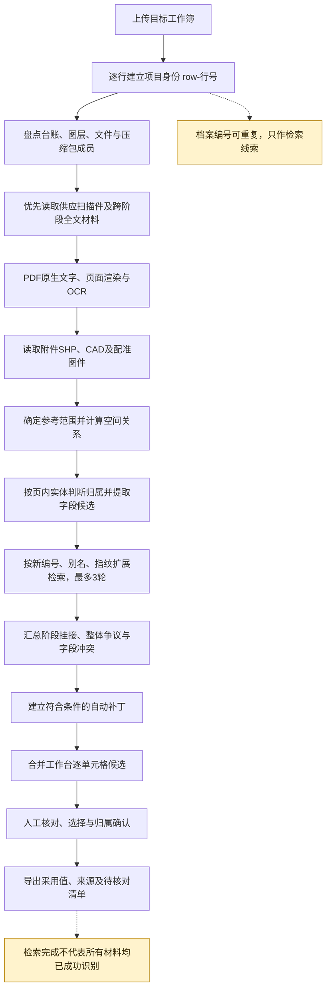
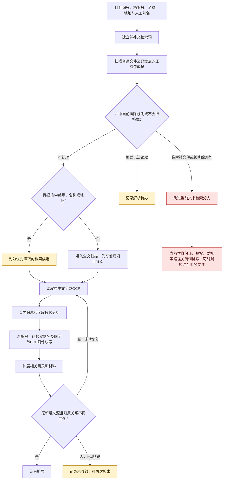
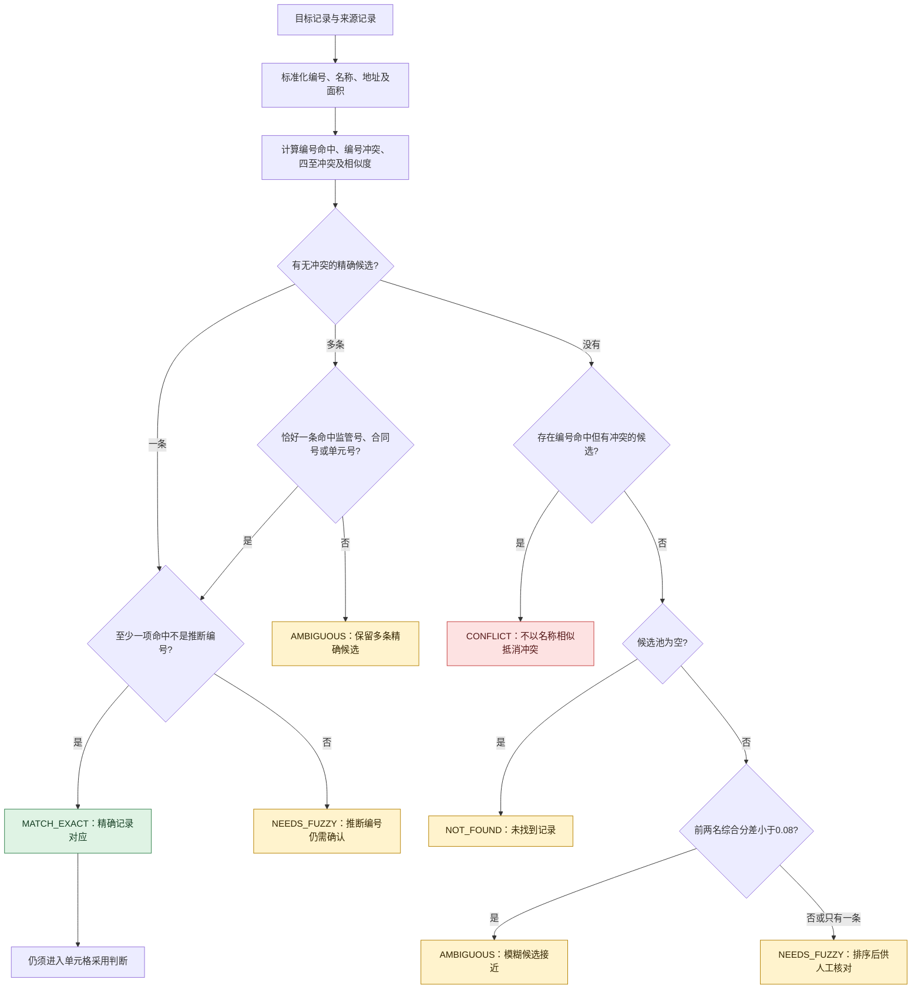
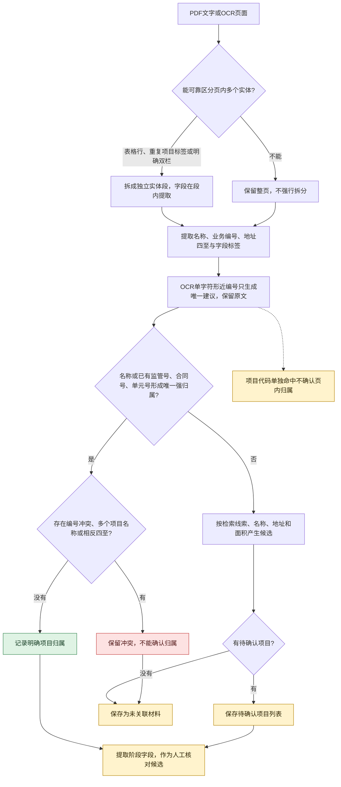
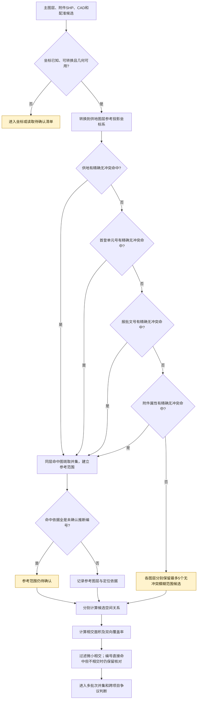
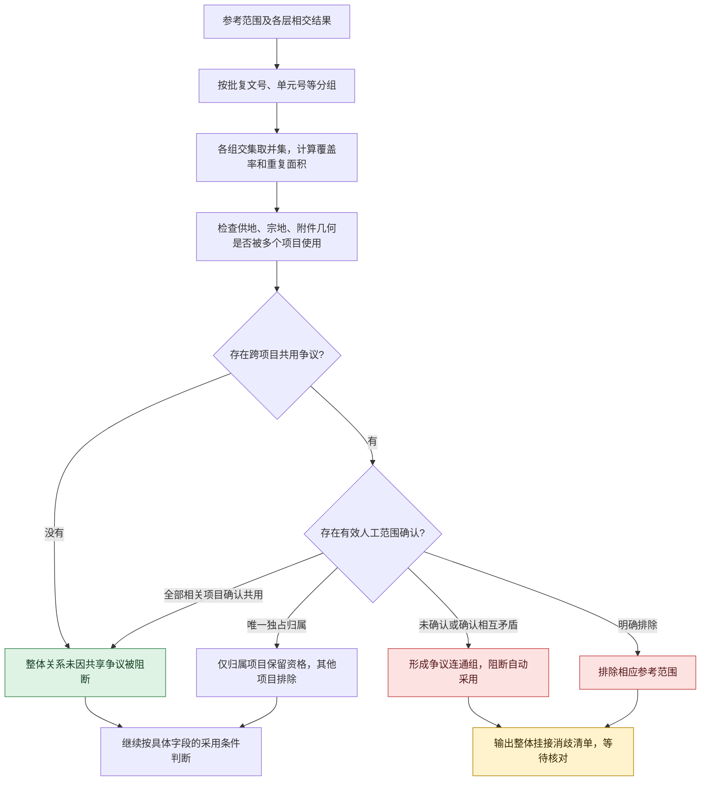
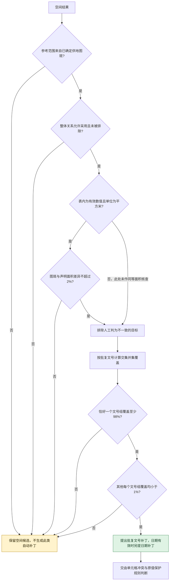
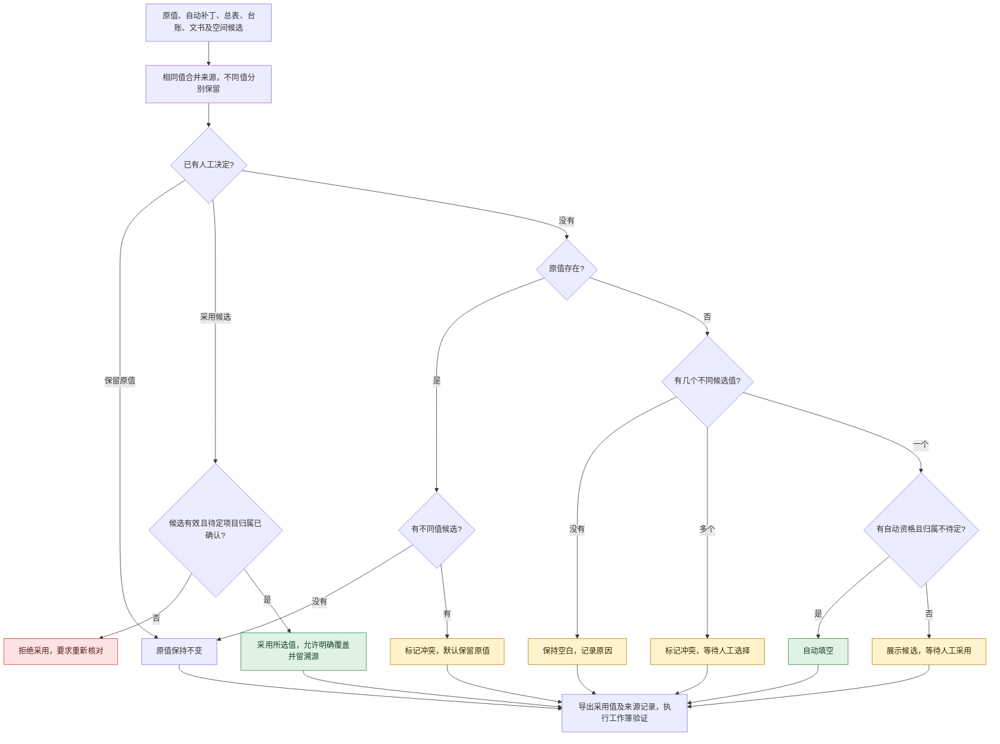
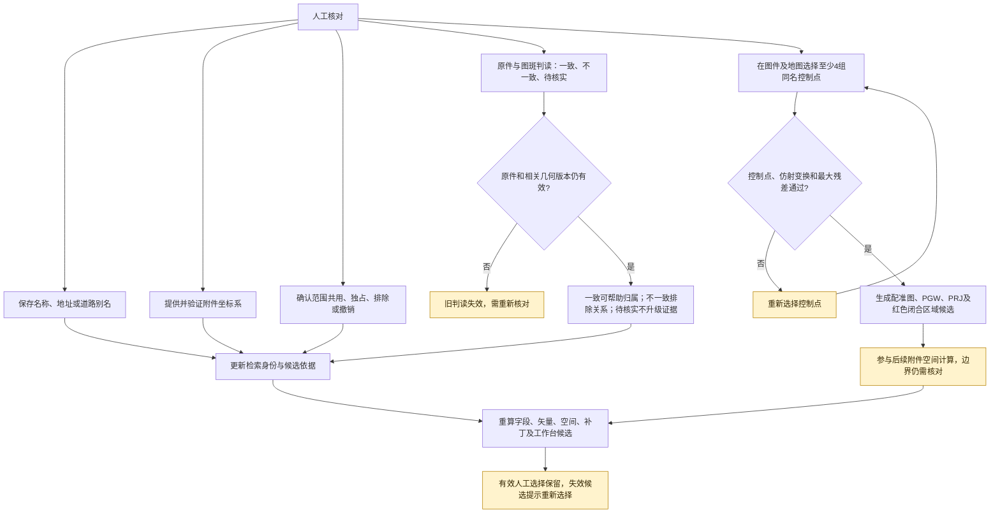
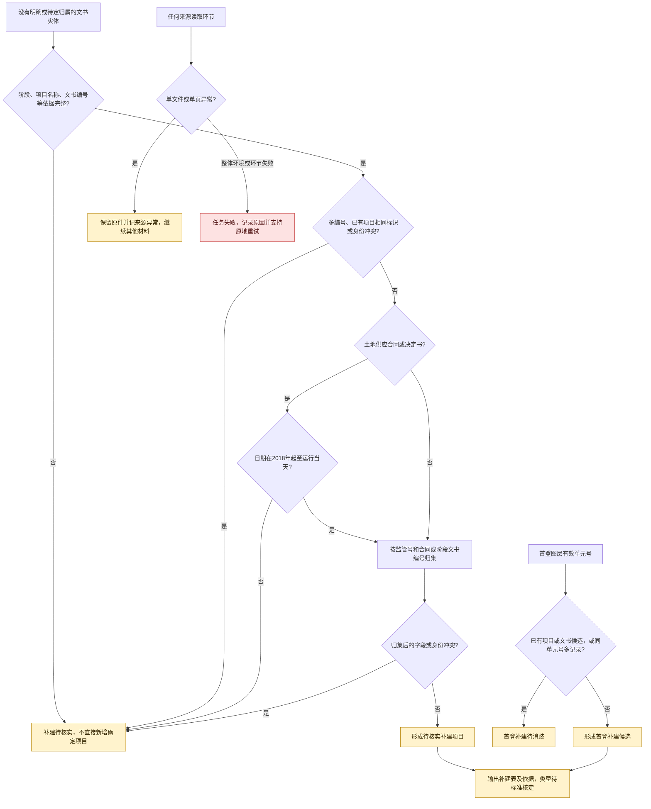

# 数据挂接流程图

依据：[数据挂接逻辑详细说明](F:/lin_shi_project/gan-jiang-one-map-data-analyse/数据挂接逻辑详细说明_20261023.md)。日期：2026-10-23。

共 10 张图。绿色为满足限定条件的明确结果，黄色为候选或待核对，红色为冲突、异常或阻断。图中的“明确归属”和“自动填空”分别判断；名称相近、目录命中、空间相交均不能单独保证字段自动采用。

## 图 1：业务总流程

## 图 2：文件检索与再次扩展

说明：名称模糊检索阈值为 0.80，保留业务描述参与比较。附件指纹要求字节完全相同；同文书重新扫描不保证命中。指纹关系主要扩大检索，不直接批准字段回填。

## 图 3：结构化记录的精确与模糊匹配

候选池准入：编号精确命中，或名称相似度≥0.45，或地址相似度≥0.65，或面积误差≤2%。综合分为 `0.55×名称 + 0.25×地址 + 0.20×面积得分`。模糊综合分仅用于排序，没有按高分直接自动通过的规则。

## 图 4：页面拆分、OCR纠错与项目归属

说明：归属判断在每个实体内进行。导出仍按“页面＋实体段”保留边界；同一实体的PDF文字与OCR矛盾会形成冲突。当前仅处理有限版式和单字符纠错。

## 图 5：空间参考范围与相交候选

普通相交门槛为 `max(1平方米, 参考范围面积×0.1%)`。附件仅在 `READY` 且有正面积面几何时参与。报批锚点可能是整批范围，不代表项目独占范围；存在空间候选也不直接代表可自动填字段。

## 图 6：多宗地、多批次与整体争议

说明：允许一个项目对应多宗地、多批次。共同使用报批批次本身不按宗地独占争议处理。当前保留关系并阻断歧义，不自动推断项目拆分或合并。

## 图 7：空间证据自动补批复文号与日期

说明：不复制整批面积，不用批次名称代替日期。此处明确画出当前面积单位检查的限制，不能将其理解为所有单位均通过同等核查。

## 图 8：单元格最终采用与导出

说明：待核对、冲突、空白也会随成果保留，但未采用的候选不会写成确定值。新识别文书字段即使明确归属，仍不因“只有一个值”而自动通过。

## 图 9：人工反馈与配准如何进入重算

说明：控制点拟合默认最大残差容限 2 米，以提交值为准；低残差不等于真实测绘精度。配准保存后生成的附件在后续空间计算中使用，不表示仅点击保存即已经完成所有重算。

## 图 10：补建项目与来源异常

补建候选不等于正式入库。目录组织标准、项目类型新标准和实际 DWG 坐标系尚未补齐；以上图示不消除这些待核对条件。
